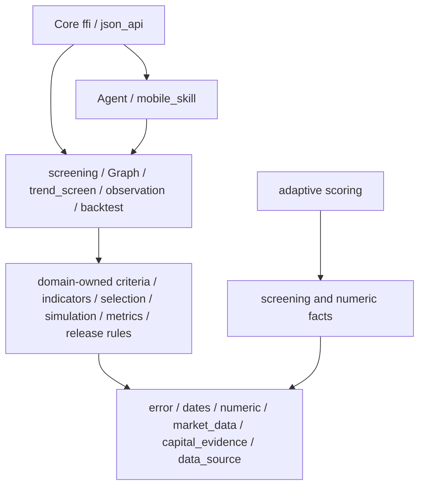
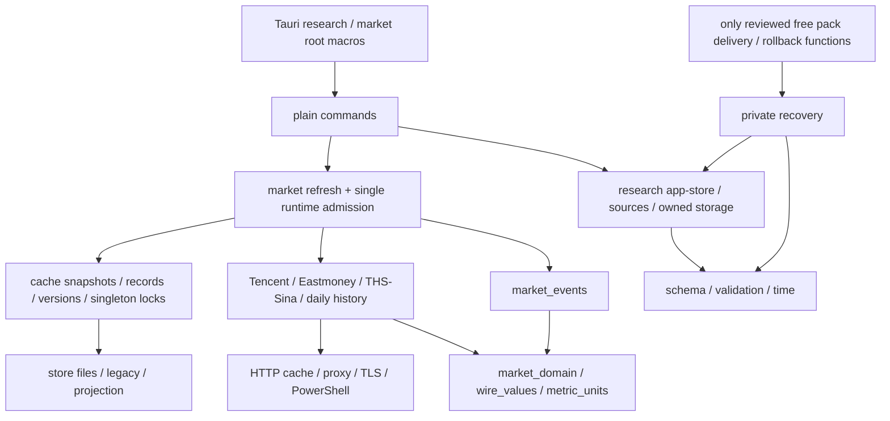

# God Module governance

This report records the implemented scope, preserved contracts and observed verification for the approved governance plan. Final engineering acceptance requires the independent whole-change review recorded in `.superpowers/sdd/2026-11-15-god-module-governance/project-review.md`; release and qualification have separate boundaries.

## Scope and current outcome

The approved work preserves behavior while extracting core, Tauri research and market responsibilities. Task1 also isolates the CPU-permit cancellation regression. Tasks1–8 were integrated after independent Spec, Standards, Implementation Quality and Verification & Evidence decisions; their immutable source/body/state/contract evidence is retained under `.superpowers/sdd/2026-11-15-god-module-governance/`.

Public signatures, serde fields/defaults/renames/omissions, Tauri command names/arguments/JSON/errors/events,15 C symbols and allocation/free rules remain unchanged. Scoring, current Graph `relation_count=0` compatibility, PIT/order timing, units, missing-data rules, provider fallback/budgets, SQLite/cache formats, per-operation connections and lock/generation/cancellation ownership are preserved. No new common/models/utils owner or production AST dependency was introduced. No commit/push, device installation, release, default-parameter activation or user-data migration is claimed.

| Integrated phase | Result and decisive preservation evidence |
| --- | --- |
| Task1 runtime | Private per-test CPU lanes remove global-counter interference; Windows4/Android2 production permits and destructor ordering unchanged. Deterministic red, synchronized cancellation/cleanup/reuse, bounded10s waits and native parallel checks are retained. |
| Tasks2–6 core | Facts/sources → screening/Graph → trend/observation → backtest/release → Agent/mobile/JSON/FFI. All437 original declarations and108 original root test/helper declarations are accounted for; private backtest implementation tests relocate without exposing fields. |
| Task7 Tauri research | Types/time/schema/validation/storage/documents/conversations/retrieval/vectors/evidence/sources/packs/app-store/commands/background have explicit owners.277 original callables/35 Store methods, private recovery/HK children and four externalized test modules remain preserved. |
| Task8 market | Transport/domain/value/event/provider/store/cache/refresh/command owners preserve234 original callables/three methods/51 declarations/15 macros/eight singleton states. Five complete cache tests relocate; actual final Android Debug/aarch64 APK passes. |

Physical root size is recorded as evidence, not an acceptance policy:

| Root | Baseline physical lines | Current physical lines | Current byte SHA-256 |
| --- | ---: | ---: | --- |
| `native/gp-core/src/lib.rs` |10,451|217|`4ea60e3d2427697778062d58ee2d523a629be6d272b373ca60fea3c0533212a1`|
| `desktop/src-tauri/src/research.rs` |8,397|174|`a92f68515bfb4c0434f38a8c280ea53838d4171ada37fe9694f19b8447212cb6`|
| `desktop/src-tauri/src/market.rs` |6,916|104|`3630bb45d9cd5823b1a4accefb57ae9dc312c7d7b86e71619fba130e809dde86`|

Counting uses raw LF-byte count plus one final non-LF-terminated line when present, including comments, attributes and blank lines. Baseline bytes come from `git show ecc119e12231ea7ae5359ad76f1a0c86476c02e3:<path>`; exact commands/hashes are in `evidence/task-9-documentation-draft/source-counts.json`. Historical Task7 extraction173 and compact Task8 ledger102 remain historical; current174/104 include the later reviewed import annotations. Reporting corrections do not imply source changes or define a LOC threshold.

## Domain and dependency map

Arrows mean “imports or invokes”. The maps describe approved source ownership, not a total order or a semantic proof of transactions/locks.



Ordinary screening does not acquire an adaptive dependency. Agent/JSON/FFI adapters call domain services; underlying domains do not depend on those adapters. Public root exports are explicit; private implementation types remain within their domains.



The pack exception is limited to canonical `import_research_documents`/`rollback_research_documents` delivery/rollback orchestration. It is not a module-wide storage exception: Store/open/connection/schema/validation methods remain prohibited from invoking recovery. Task9's independently approved canonical-identity guard enforces the same narrow caller/target boundary.

Network/value/domain/event leaves do not import market/CN/HK business orchestration; providers do not own stores/cache/refresh/commands. Refresh's original permit admission function now lives in refresh, and commands forwards once; foreground resume resolves locally. There is no refresh→commands admission backedge.

## State, data, platform and compatibility invariants

Genuinely shared core helpers such as `CoreError::new` use narrow crate visibility; BacktestHistory/PortfolioSimulation internals stay backtest-scoped. ResearchStore retains a PathBuf and opens a fresh owned Connection per operation. Connections are reused only inside the original transaction/snapshot chain. A borrowed path accessor replaces one actual private-field consumer; fields were not made public for tests. CN durable replacement versus HK transactional import/rejected rollback, privacy/as_of filtering before LIMIT, private recovery/HK children, embedding gates and all original definition cfg remain unchanged.

Market retains one HTTP client cache and the original seed/financial/data/overlay caches and UPDATE/READ/MIGRATION authorities. Cache versions cover SQLite/WAL/SHM/legacy metadata and checksum identity; raw/typed Arc views remain. Original held-guard envelopes are preserved, including the known cold-cache paths; no unvalidated incidental lock redesign occurred. Successful financial/reference/history/security updates remain independent of later quote/provider failure or cancellation.

Transport preserves explicit proxy precedence, environment bypass for scoped modes, uncached redirect-policy clients, Android aws_lc/WebPKI and complete Windows/non-Windows fallbacks. Original budgets remain cache16, batch120/concurrency12/candidate8000/default failed-batch4; connect3s/request6s/batch8s/probe4s; financial6s/preferred route3s/history8s; webview1MiB/model list2MiB; daily history2000; warmup80/concurrency24/lookback500days/minimum60bars. Defaults and ceilings remain distinct. Financial zero/negative/missing values, periods/provenance, code leading zeros and HK currency/adjustment behavior are unchanged.

## Frozen contracts, tests and fingerprints

| Inventory | Original boundary | Current observed result |
| --- | --- | --- |
| Public core |164 exports/aliases and8 method contracts|Unchanged frozen public comparison|
| Tauri roots |15 research +15 market macros|Original names/types/args/order/async and direct delegation preserved|
| C ABI |15 symbols|Real DLL50 baseline cases +6 synthetics; null/invalid UTF8/JSON/panic/free contracts preserved|
| Core tests |129 identities,1 original ignore|128pass/1ignore; six reviewed private backtest relocations|
| Native gp-research tests |80 identities,0 ignores|80pass across lib/CLI/integration targets|
| Tauri native tests |827 original identities,8 ignores|830 identities after three authorized runtime additions;822pass/8original ignores; five reviewed cache-test relocations|
| Frontend |13 original enum-contract tests|All13 preserved; full940pass across116 files, build passes|

Original IDs/ignores are immutable; mappings are explicit and injective, with counts used only as corroboration. The two original research CI names each have one actual listed and one actual passing executed case:

```text
research::tests::fixed_retrieval_eval_suite_enforces_governance_invariants
research::tests::schema_v2_migration_keeps_user_imports_private_and_public_docs_exportable
```

Complete symbol/identity/ignore/mapping inventories are in frozen baseline files and `evidence/task-9-final-evidence-index.json`; the main report does not replace them with aggregate counts.

Core source identity covers65 production Rust paths and67 ordered labels including Cargo metadata. Current observed core fingerprint is `3acf05bab08b83bae6c0f82a498dae647d64414ec6d39ffdc861bd528a5063da`. Native gp-research retains its original11 Rust sources plus Cargo.toml/lock under `gp-research-implementation/v2-lf\0`. The existing desktop adaptive-release inventory retains its nine source/metadata inputs plus two core/research fingerprint values. Tauri research/market are absent from those pre-existing production inventories; no new protocol was invented for their extraction. New files enter an inventory only when an actual body is extracted from a fingerprinted owner.

The ordered v2-LF source framing and existing fixed-v1/strategy/unit versions are preserved. Source identity legitimately changes after extraction, without normalizing dataset/fixture/parameter/report/receipt/cache bytes or rewriting old qualification evidence. The exact ordered paths/labels are available in `task-6-final-inventory.json` and `task-7-fingerprint-scope.json`.

## Observed verification and reuse

`evidence/task-9-final-evidence-index.json` contains40 actual command/log records with explicit cwd/cache/exits/log SHA-256 and source-association references. Passing results can be reused only when their relevant input hashes remain exact; no draft preparation reran a build/test/runtime action.

| Gate | Source-associated evidence and observed result |
| --- | --- |
| Core/research full |`task-6-check-exits.json` +`task-6-source-association.json`;128/1 core,80/0 research. Relevant final sources remain unchanged. |
| All-crate fmt/clippy |`stable-core-check-results.json`, `stable-research-check-results.json`, final native fmt/clippy records; current input hashes verified. Existing core diagnostics reconciled; research clippy passes without warning messages. |
| Native default/all-features |Final v3 records,830 unique/822pass/8original ignores; exact source100 association. |
| Three consecutive default-parallel native runs |`task-9-final-native-three-results.json`: three actual830/822/8 passes with the same185 protected before/after inputs and default test threads. |
| Frontend exact/full/build |13 names/assertions/native enum sets preserved; exact1pass/12 selection-skipped, full940pass/build. Three-input/log association is transparently reconstructed, not relabeled as capture at spawn. |
| Real Android |Original `scripts/build-android.ps1 -Debug -Target aarch64`, exit0;189 protected inputs unchanged. APK540,317,434bytes SHA-256 `5ce58e5b0cd7adeab2c6f82e2b7f0160538fde63d2bea4c3c43861f7e93e3914`; sole arm64 library matches current compiled target. |
| DLL/API |Actual15-symbol/50-case/6-synthetic probe and frozen public/command comparison pass. |

Existing warnings and manual/live exclusions remain explicit, including core diagnostics,144 native Windows clippy messages and72 Android platform messages; source-origin reconciliation is retained. The complete one core/eight native ignored IDs are in the immutable ignored inventory. A selected test run's temporary filtered/skipped cases are not new ignores. Core clippy's25 diagnostics match the immutable original corpus (27 warning lines including summaries); native clippy's144 diagnostics match original canonical owners/messages. Android's72 rustc platform diagnostics remain disclosed separately; original definitions/cfg and the targeted import annotations are covered by Task8's complete source review. The standalone development guard passes clippy with `-D warnings`. These distinct diagnostic categories are not combined into a claim of a warning-free application.

## Scoped rulings and costs

The verbatim appendix below and `evidence/task-9-final-rulings.json` retain all five literal `progress.md` Ruling lines with source hash/line number. The following compact map also includes scope decisions recorded in amendments; it does not create new authority.

| Decision | Rationale and boundary | Cost if wrong / verification |
| --- | --- | --- |
| Writable linked checkout and serial owners |Explicit linked workspace replaces an unwritable managed checkout; old checkout retained. One product owner, independent read-only reviews. |Wrong checkout or concurrent contamination; explicit cwd/manifests and immutable source hashes verify ownership. |
| Runtime local lanes/bounded tests |Global unrelated permit activity invalidated the old assertion; isolate only the test lane and preserve production permits/drop ordering. |Leak or hanging regression; deterministic red, channels/poll/joins, bounded10s waits and three parallel passes. |
| Frozen fixture restoration |Initial Git stdout attempt did not restore hashes; corrected using exact clean-baseline bytes and `-text` attributes. |Treating altered input as code regression or changing byte identities; preserve failed attempt and verify all six declared payload hashes. |
| Narrow fields/test/accessor seams |Six backtest test moves, research borrowed path accessor and market consuming four-value tuple avoid exposing private fields or changing connections. |Lost coverage or lifecycle/field exposure; complete bodies, mappings, method/private/state audits and actual cases. |
| Root api_market_refresh local mut |Only root binding mutability removed; original child mut/body and frozen public/macro metadata retained. |Unmodeled macro dependence; exact source/public/native/Android comparisons. |
| Frontend two-owner source adapter |Only test input changes; exact regex/13 names/assertions/10-risk order retained, no concatenation. |Translation coverage loss; old/new values and940 full cases falsify it. |
| Gradle metadata fallback |Original3arg first; UnauthorizedAccess-only4arg retry after exact content/security parity; unchanged final descriptor/cleanup. |Partial-state or ACL change; red/green5.1 fixtures, actual security/byte checks and successful build. |
| Windows import alignment |Actual Android E0432 required12 specific import cfg attrs/one service annotation; definitions/bodies remain original. |Wrong platform visibility or hidden warning; scoped source proof, fresh native/CI and actual Android. |
| Narrow pack role + refresh admission |Only two reviewed free delivery/rollback functions may call recovery; no Store exemption. Original runtime admission body moves whole to refresh, commands forwards once. |Role overreach or acquire/drop/cancellation change; canonical negatives, exact body/one-permit/public/test/Android proof. |
| Optional Gradle ZIP/build caches |Process override retains omitted8.14.3 default; reuse installed9.7, short/public offline caches, in-process Kotlin and workspace debug home. |Version/permission/cache drift; nine fixtures,710 exact files/seven directory entries, real wrapper9.7 and actual APK, unchanged189 inputs. |
| Model fallback |Astra high-demand/service failure supplied no review or approval. Available Sol performs bounded independent artifact review with the same mandatory four axes. |A subtle combined defect may be missed; retain phase/specialist reviews and require explicit final whole-change decisions, without lowering criteria or claiming acceptance from failure. |

No scoped ruling authorizes a release, data migration, parameter/default switch, broad lint or baseline waiver. Earlier unsuccessful approaches remain evidence.

## Conditional qualification gap

Qualification is **unrestored**. Repository-only assessment found synthetic tiny/long regression fixtures, not an authoritative authentic gp-pit/v1 bundle with frozen original calibration invocation/options. Hash validity, full-universe flags and synthetic60-month test length do not establish real-market provenance. No production app-data/DB/credentials path was guessed or opened.

Normal calibration/v2 must use genuine identical data/options after final source/lock/version freezing, preserving36 training/12 validation/60 test months,120 warmup sessions,31-session purge and original option omission/value. It derives current run/candidate identities itself and verifies immutable owned reports/receipts/test locks; old evidence must not be overwritten or relabeled. The missing real PIT/options package is a conditional delivery limitation, not permission to fabricate qualification or promote/default-switch. `task-9-qualification-scout.md` and its search/hash metadata document the bounded gap.

## Integrated guard verification and acceptance

The candidate received an independent four-axis approval after bounded correction rounds. The original F1–F7 and scoped residual controls are resolved: qself owners and unknown governed suffixes retain canonical ownership; one ordered lexical scope handles imports/type/value declarations and fingerprint calls; generic scopes restore after DTO/trait/associated declarations; module alias chains use import identity rather than value-expression spelling; narrow pack aliases, real inline-facade controls and raw workflow hashes remain enforced.37 Rust control groups and20 Python controls pass. The original18/5 and residual7/3 reviewer replays retain their negative/control results and raw logs; new alias-chain controls are also preserved.

Exactly11 reviewed guard/workflow outputs were applied byte-for-byte, with before snapshots and the original baselines preserved. Syn remains confined to the standalone development crate. The new `.t9` cache and named fixtures leave the old AST executable/cache intact. Real entry-point verification records17 passing gates: Rust controls, frozen public contracts, architecture/fingerprint all, tool fmt/strict clippy, Python controls, seven original-identity log checks, the separate all-feature identity check, both actual exact CI list/run/checker routes and diff whitespace validation. Every gate records unchanged189 application inputs plus the applied tool/workflow hashes.

The CI change keeps both original exact test names, locked Cargo builds and separate raw list/run logs. Native process failures are returned before the checker; zero/ignored/wrong/duplicate selection cannot pass. The workflow's trusted judge, existing notification purpose and read-only permissions remain preserved. This delivery edits the workflow locally; remote CI execution is not claimed.

The first actual exact-test route retained exit101 when the parent process's `CARGO_NET_OFFLINE=true` was interpreted by ort-sys as a request to skip its installed binary cache. Recovery kept Cargo's explicit `--offline` flag through the approved `run_gate` API, selected the already installed matching ORT cache and verified its two binary-file hashes before/after. Both recovered list/run/check routes then exited0. The initial raw log and `task-9-parent-real-guard-initial-results.json` remain intact; `task-9-ci-existing-ort-cache-proof.json` records the installed build-script cause and byte identity. No library install/download, dependency/version/source or global configuration change occurred.

Syntax guards do not expand macros, infer receiver/trait dispatch or evaluate target cfg. They do not prove business/PIT behavior, serde callbacks, source-body equivalence, TLS limits, cache/schema bytes or connection/transaction/lock/privacy lifetimes. The complete phase audits and source-associated application tests/builds remain their evidence.

The final whole-change boundary includes the tracked diff and all new source/tool/document files, with current source/manifest/lock/version/fixture/frontend hashes frozen in `evidence/whole-change-manifest.json`. Engineering acceptance is recorded by the independent Project Review and the Supervisor's final checkpoint/status projection. The uncommitted worktree is retained at the original detached baseline; no release, deployment, user-data migration or default activation is part of this delivery. Qualification remains unrestored under the approved genuine-input condition above.

The local evidence paths in this report are relative to `.superpowers/sdd/2026-11-15-god-module-governance/`. Useful records are `task-9-guard-candidate-review-round3.md`, `evidence/task-9-parent-mechanical-apply.json`, `evidence/task-9-parent-real-guard-results.json`, `evidence/task-9-final-evidence-index.json`, `evidence/whole-change-manifest.json`, `project-review.md`, and `CHECKPOINT.md`. The portable frozen contracts, test IDs/ignores/maps, ABI cases and ordered ownership/fingerprint policy are in `scripts/rust-architecture/`.

## Verbatim implementation rulings

These five original decision lines are preserved in order from the immutable progress snapshot used by the documentation preparation. Their historical tense/status is not a current completion projection; their boundaries and wrong-decision costs remain visible.

`progress.md:85`

```text
Task8 Ruling: api_market_refresh facade payload local mut is implementation binding syntax, not frozen public API: original signature normalizer/established self-test strip it and frozen contract has payload:Value. Remove only unused root mut, keep original commands implementation mut/body and all args/types/order/async/Tauri metadata; no new allow annotation or baseline/tool changes. Independent raw-source audit records one exact mechanical exception and public/native/Android checks remain mandatory. Cost if wrong: unmodeled Tauri macro binding dependence; validate through review/builds.
```

`progress.md:87`

```text
Task8 Ruling/scope amendment: authorize only frontend/src/lib/observeSummaryContract.test.ts native source-input adaptation after requiredunit939/940 exposes oldlib marker dependence. Read two real trend owners separately, keep regex/allassertions/13testnames/940case count; riskbar next boundary fntrend_notes, no concatenation. Immutable adjunctsource saved, parent old/new signal/pattern/reason lists and aggregate10riskvalues/order exact; full frontend/exactcase/build and independent review required. Cost if wrong: translation coverage loss; exact values and preserved assertions provide falsification. No UI/core business/baseline/lock changes authorized.
```

`progress.md:89`

```text
Task8 Ruling/scope amendment: requiredAndroid build blocked by WindowsPowerShell5.1 metadata merge, and root/subagent escalation review service failed beforeexecution (notunsafe determination). Sandbox fixture original3arg FileReplace fails,4argignoreMetadataErrors preservesnewtarget/oldbackup; actualgenerated/adjacent Access+Owner+Group descriptors match. Authorize only guarded UseLocalGradleDistribution fallback afterUnauthorizedAccess: source/target unchangedcontent and exactsecurityparity;4arg retry within normalworkspace permissions, verifysecurity unchanged, otherwise rethrow. Keepatomicity/backup/bytes/version/allother behavior. NoACL changes/elevation/bypass/install/deploy. BeforeScriptbyte snapshot saved; extractedhelperred-green/realAndroid/independentadjunctreview required. Costifwrong: partialfile/securitymismatch; guard+test+review must reject it.
```

`progress.md:99`

```text
Task8/9 Ruling: packs physicalstorage descendants mixStore persistence andreviewedfree packdelivery/rollback orchestration. Only canonical import_research_documents/rollback_research_documents maycallrecoverydeliver/rollbacksource; no wholemodule exemption, allStore/open/connection/schema/validation remainbanned. Actualrefresh->commands admissionbackedge willbe corrected bywholeunchanged runtimepermit admissionfunction movingtorefresh, commandsplainforwarding/rootmacro unchanged, resume callslocaladmission once. Two-file beforebytes saved; no changinglive-testsource; freshcombinedfinalchecks/scopedreviewrequired. Costifwrong: admission/drop/order orrole overreach; exactoriginalbody/onepermit/public/test/Android andsource-review evidence mustfalsify.
```

`progress.md:108`

```text
Task9 Project Review Ruling: most-capable Astra preparation dispatch returned only high-demand service failure, no review or approval. Use available Sol for bounded artifact-based independent whole-change review with the same four mandatory axes, original complete-source audits and final frozen patch/log association. Cost if wrong: a subtle combined defect may be missed by the fallback; preserve independent phase/specialist reviews and require explicit whole-change evidence decisions, without relaxing any criterion. No unchanged Astra retry or project acceptance claim.
```

